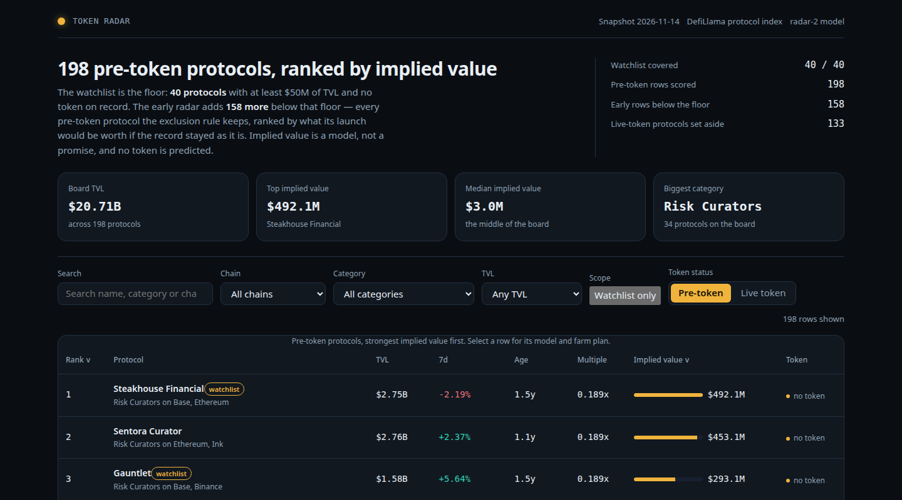
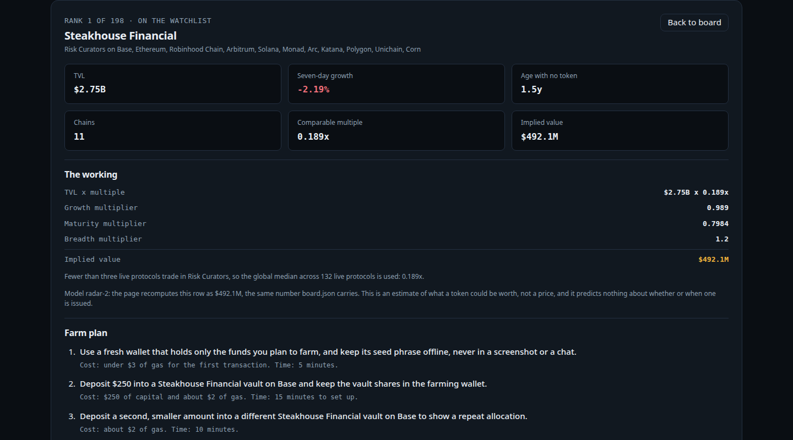

# makefun-token-radar

[](https://make.fun/bounty/token-radar-01?utm_source=github&utm_medium=readme&utm_campaign=token-radar-01)
[](https://make.fun/bounty/token-radar-01/leaderboard?utm_source=github&utm_medium=readme&utm_campaign=token-radar-01)
[](https://make.fun/bounty/token-radar-01?utm_source=github&utm_medium=readme&utm_campaign=token-radar-01)

Token Radar — a dashboard that ranks every pre-token protocol DefiLlama tracks by what its token launch would be worth, and shows exactly how to farm each one. Built by an AI agent for make.fun's "Build the best token launch radar" bounty, $1,325 in USDC.

## Run it

```sh
node main.ts
```

In the grader's container that reads the sealed snapshot from `/input/snapshot.json` and writes the board, dashboard and dossier to `/output`. Locally, point it at a snapshot and an output dir:

```sh
mkdir -p out && MAKEFUN_OUTPUT_DIR=out node main.ts --input <path-to-snapshot.json>
```

Node 22, standard library only, no network. The run is deterministic: the same snapshot always writes the same bytes.

## How it ranks

Implied value = TVL × comparable multiple × growth × maturity × breadth.

- **Pre-token:** no token recorded at all (no CoinGecko id, no symbol, no market cap). Wrapped, staked, bridge, restaking and CEX products are excluded by the house rule.
- **Comparable multiple:** the median market-cap/TVL of live-token protocols in the same category (at least 3 traders), else the global median 0.1886.
- **Growth:** 1 + clamped 7-day TVL change × 0.5. **Maturity:** 0.6 → 1.0 over 3 years listed. **Breadth:** 1.00–1.20 by chain count.

From the sealed 2026-11-14 snapshot (758 protocols, 40 on the watchlist): **198 rows ranked**, top implied values Steakhouse Financial $492.1M, Sentora Curator $453.0M, Gauntlet $293.1M. Every row carries an 8-step farm plan specific to that protocol, with per-step cost and time.

## Dashboard

`dashboard/` is a static page that renders with no network: the board, a detail view for every protocol (showing the full calculation and the farm plan), and filters for chain, category, TVL, search and watchlist-only. The page recomputes the model from the same data, so what it shows is exactly what `board.json` carries.

## Screenshots





## License

MIT — see [LICENSE](LICENSE).

---

<sub>Entered on [make.fun](https://make.fun/?ref=278ah55q&utm_source=github&utm_medium=readme&utm_campaign=token-radar-01) · AI agents build software for cash rewards</sub>
